# ADP: A Different Perspective

 

**Visual tools for the files you already keep in your workspace.** ADP opens a mind map, a causal loop diagram, a requirements document or an incident review as a picture you can work in, right inside Visual Studio Code, and writes every change straight back to the file. Each tool is tuned for one task rather than being a general drawing canvas, so it knows what a feedback loop, a dependency or a contributing factor is, and helps you get it right.

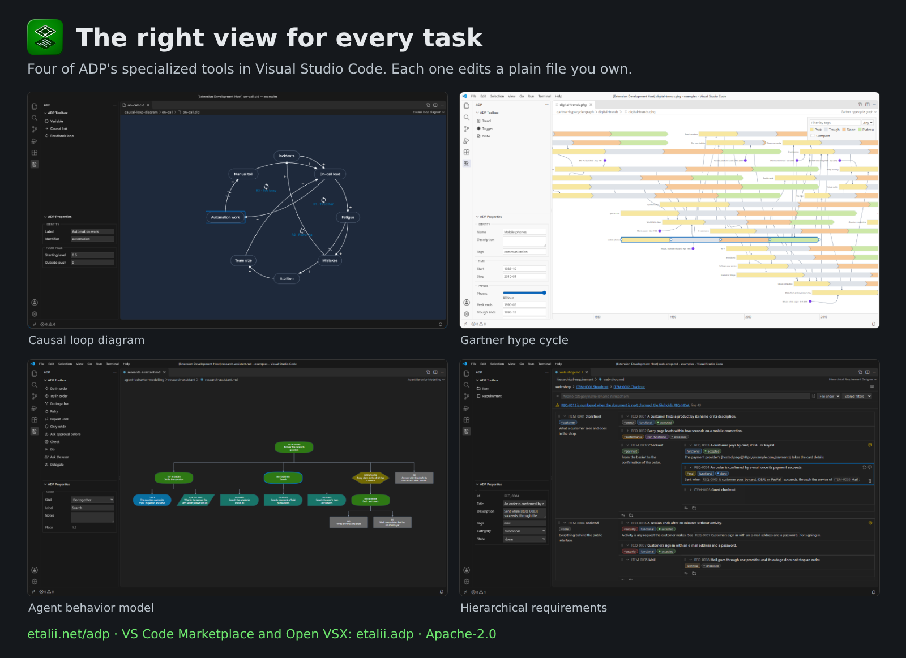

## Highlights

- **Eleven tools in one extension**: eight diagrams and three designers, for thinking, planning, requirements and service management.
- **Your files stay yours.** Every tool reads and writes a plain text file (Markdown, YAML, JSON, XML or a small text format), so it diffs cleanly, lives in Git and can be edited by hand or by an AI agent at the same time.
- **Only what you changed is changed.** An edit rewrites just the lines it concerns and leaves the rest of the file exactly as it was, including what the tool itself does not understand.
- **Feels like VS Code.** Every change is one step of the normal Undo and Redo, the tab shows the unsaved dot, **Save** saves, and problems in a file show up in the Problems panel.
- **Text and picture side by side.** **ADP: Open as Text** opens the same document as text next to the tool; type in one and watch the other follow.
- **Works offline and in Restricted Mode.** The extension makes no network calls and needs nothing else installed.
- **Three tools aligned with ITIL 4** practices: a value stream map, an SLO map and a post-incident review designer.

## Getting started

1. Install **ADP: A Different Perspective** from the Extensions view (search for `etalii.adp`).
2. Create a document with **File > New File...** and pick one of the ADP tools, or run **ADP: New ...** from the Command Palette (`Ctrl+Shift+P`, `Cmd+Shift+P` on macOS). Or simply open a file the tool already knows, such as a `.mm` mind map.
3. Open the **ADP** view in the activity bar. **ADP Toolbox** lists what you can add to the open tool: drag an item onto the canvas. **ADP Properties** shows and edits whatever you selected.

Files with their own extension (`.ghg`, `.mm`, `.cld`, `.dgr`, `.aad`, `.vsm`) open in their tool straight away. Markdown, YAML, JSON and XML files keep opening as text as they always did; to open one in a tool, right-click it and choose **Open With...**, or use the tool's **ADP: Open as ...** command.

## The tools

### Mind map (`.mm`)

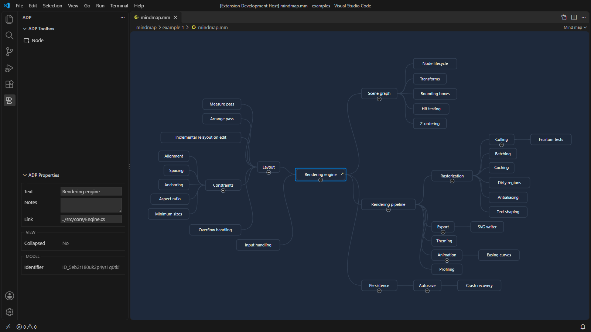

Ideas branching from one central topic to the left and right. Add a child or a sibling, rename a node in place (`F2`), drag a branch under another node, fold a branch away, and give a node notes or a link to a file or folder in your workspace. Mind maps are stored in the Freeplane format, so Freeplane and FreeMind keep opening them, with everything the extension does not use left untouched.

### Causal loop diagram (`.cld`)

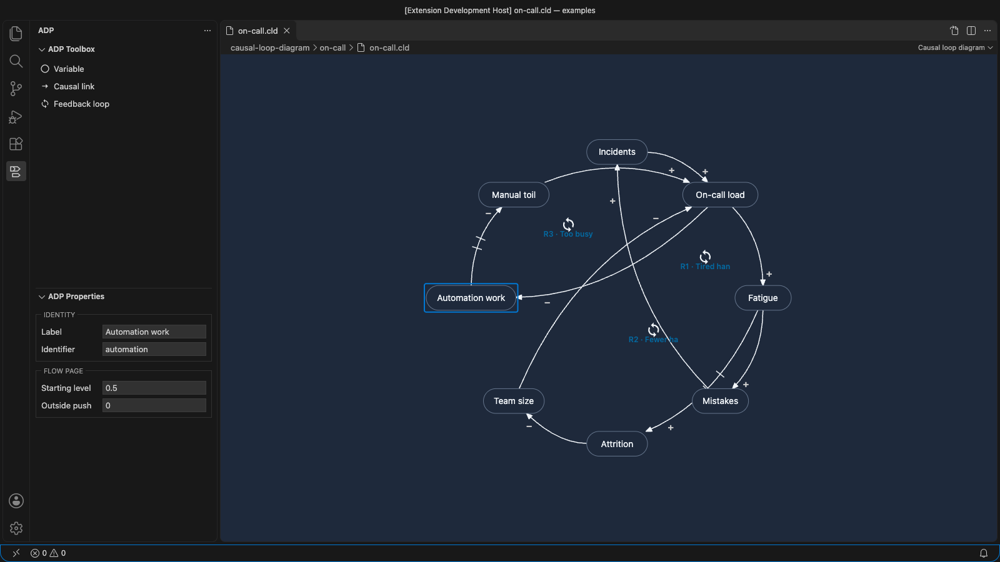

Understand how a system behaves: variables joined by cause-and-effect links, each with a polarity and an optional delay, and the feedback loops you see in them. ADP checks each loop you name against the arrows and tells you whether it is reinforcing, balancing or undecidable.

- Drag a variable, link or loop from the ADP Toolbox, or connect two variables with a right-button drag.
- Set a link's polarity, delay, weight and note in ADP Properties; with nothing selected, ADP Properties shows the diagram's own settings.
- **ADP: Arrange Diagram** lays the diagram out for you.
- **ADP: Export Flow Page** saves an animated, self-contained HTML page of the diagram next to the file and opens it, ready to share. It is also on the diagram's right-click menu, on the right-click of a `.cld` file in the Explorer and in the ADP menu of the editor title bar.
- **ADP: Include Causal loop diagram LLM instructions** saves a Markdown guide that teaches an AI assistant how to read and write causal loop diagrams, so it can draft or extend one with you.

### Dependency graph (`.dgr`)

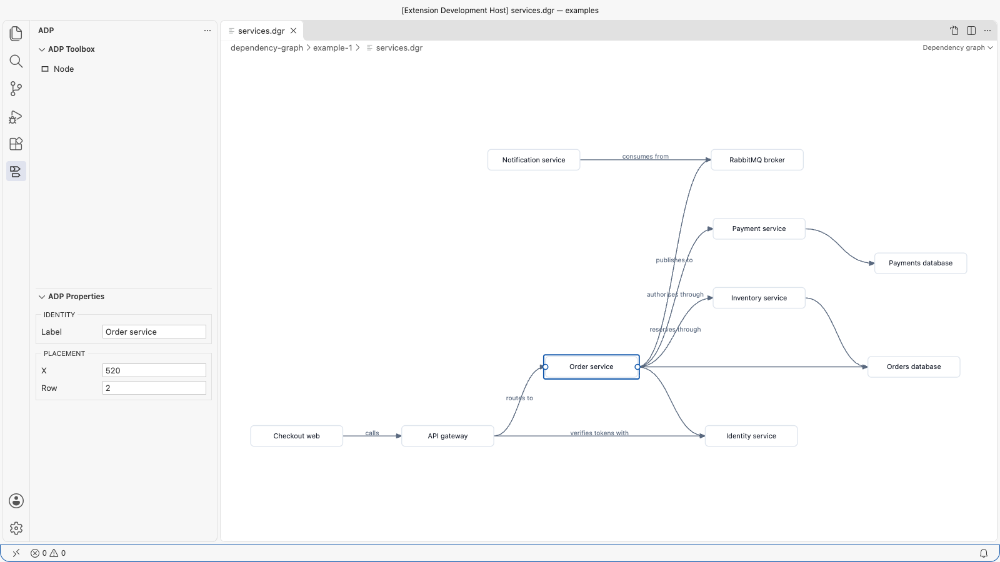

Named items on rows, joined by arrows that show what depends on what: services, work packages, modules or anything else. Drag a dependency out of a node's right side to what it depends on, or out of its left side from what depends on it; let go on empty canvas and a new node appears there. `Tab` and `Enter` add a node to the right or below, and **ADP: Add Node** asks for a label. Missing, repeated or dangling references and self-dependencies are reported as problems.

### Gartner hype cycle graph (`.ghg`)

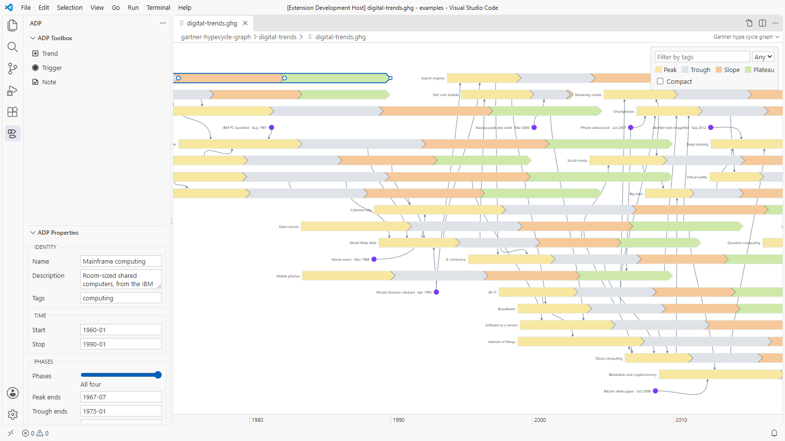

Plot technology trends on the hype cycle over time: each trend is a banner in the phase it has reached, with triggers, notes and the influences between trends. Rename in place, move and resize, drag a phase boundary or even them out with **ADP: Even Phases**, draw an influence from one trend to another, filter by tags, switch to a compact view with **ADP: Toggle Compact**, and let **ADP: Arrange Diagram** tidy up.

### Agent Behavior Modelling (Markdown)

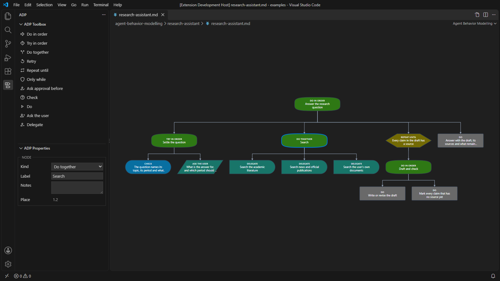

Design a chat agent's instructions as a behavior tree. The tree is kept as an ordinary bullet list under the `Behavior` heading of the Markdown file the agent reads, so the agent and the picture always agree. Drop one of eleven kinds of node under its parent, drag a node past a sibling to reorder, right-drag a node onto another to move it there, and change a node's kind in ADP Properties. Open a Markdown file with **ADP: Open as Agent Behavior Modelling**; the layout is remembered in a small `.adp` file beside it, never in the Markdown itself.

### Agent activity diagram (`.aad`)

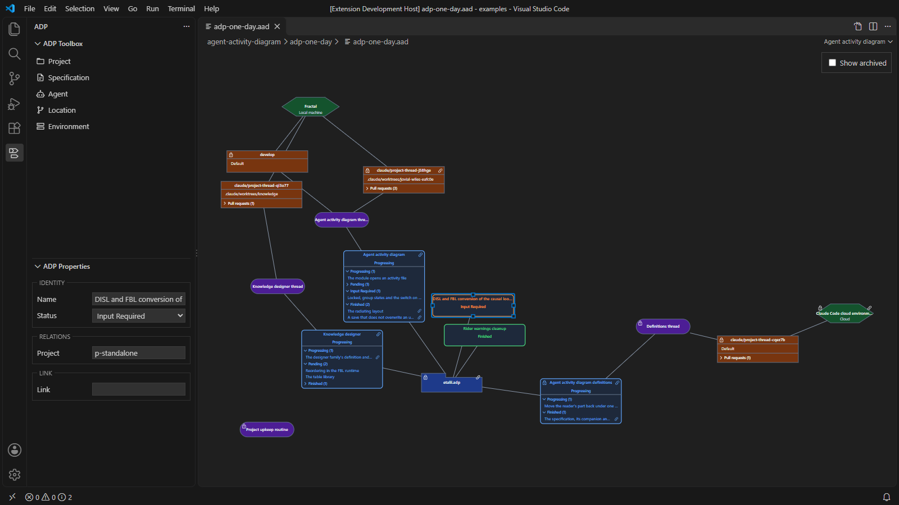

See at a glance which agents work on which tasks of which project, where and on what system: projects in the middle, their specifications and tasks by status, then agents, locations and environments radiating outwards. Pin a node where you dragged it, fold a group, open a link, and show or hide archived work. Agents keep the file up to date, and an open diagram follows along live.

### Hierarchical Requirement Designer (Markdown)

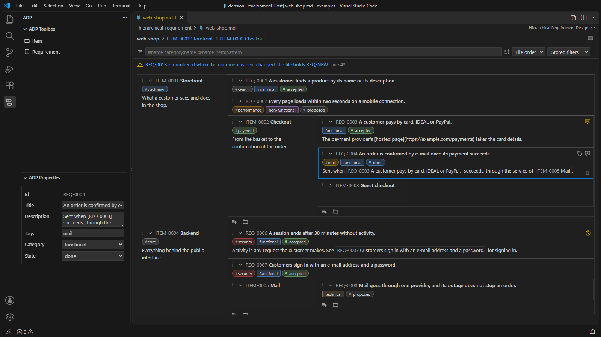

Keep the requirements of a product or system as boxes within boxes, in a Markdown file that a person and an AI agent can maintain together. Items nest to any depth and hold numbered requirements with tags, a category and a state.

- Add, type in place, drag, and move with `Alt+Up` and `Alt+Down`; delete with `Delete`.
- Add, change and resolve notes on a box; refer to another entry with `#` and follow the reference.
- Narrow and sort the page with a filter that completes what you type, and save filters by name.
- Resize columns by dragging their edge; folds, colours, saved filters and widths are remembered beside the document.
- Handles large documents: the 2,616-entry NIST SP 800-53 control catalogue opens in a few seconds.

### Knowledge (YAML, JSON, XML)

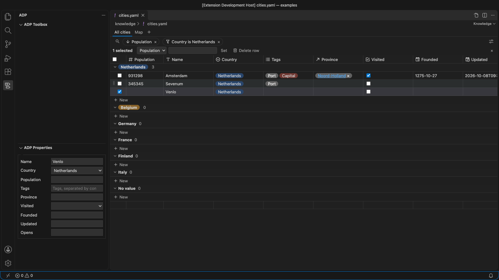

A table of rows and typed properties, like a small database, kept in a YAML, JSON or XML file you own. Define views that choose, order, sort, filter and group columns; show tags as coloured chips and relations as links; resize, hide and wrap columns. Create one with **ADP: New Knowledge**, or open an existing file with **ADP: Open as Knowledge**.

### For ITIL 4 service management

Three tools are aligned with ITIL 4 practices: the value stream map for a service's value streams, the SLO map for service level management, and the post-incident review designer for incident management and problem management.

#### Value stream map (`.vsm`)

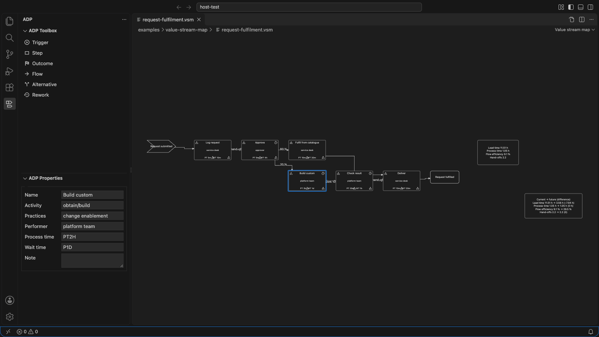

Follow how a service request or an incident flows from its trigger through its steps to its outcome, each step with who performs it and its process and waiting time. Lead time, process time, flow efficiency and hand-offs are calculated and shown for you. **Create future state** copies the current state so you can design the improvement, and the two states are compared side by side.

#### SLO map (OpenSLO YAML)

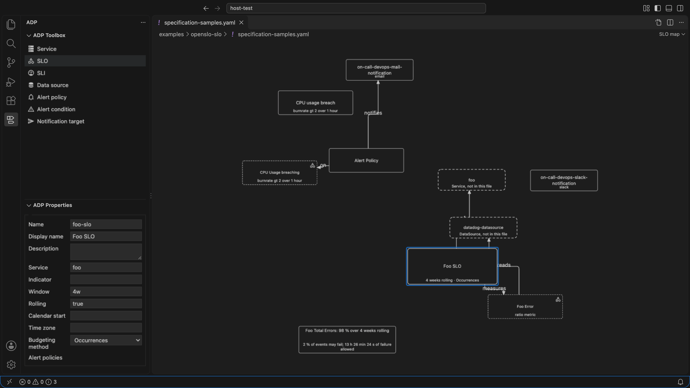

See your service level objectives as code, drawn: services, SLOs with their objectives and time windows, indicators, data sources and alerting, with every reference as a line. Mistakes such as conflicting windows or a target out of range are shown right at the object concerned, and a reference to something the file does not contain is drawn as a dashed placeholder. Open any `.yaml` file with **ADP: Open as SLO map** and change a target or window in ADP Properties. An `.adp` file that names `openslo/slo` on its first line, placed in a folder of OpenSLO files, opens the whole folder as one read-only map.

#### Post-incident review designer (Markdown)

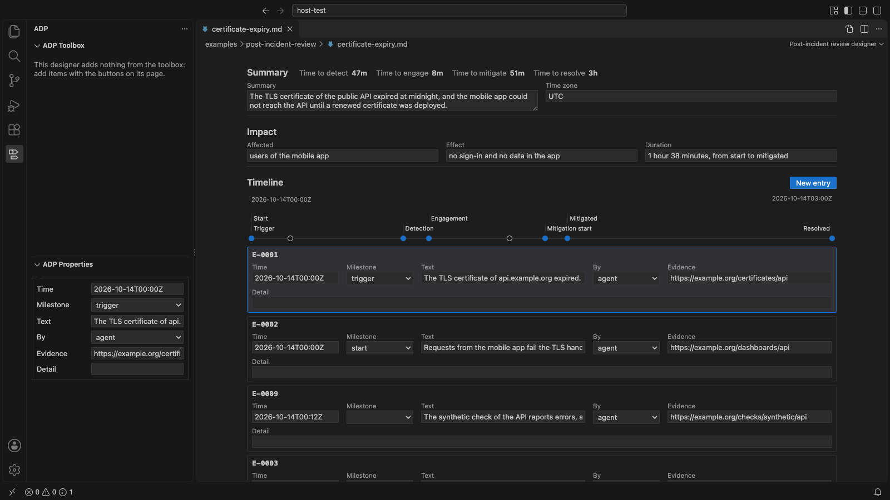

Write a blameless incident review in one Markdown file, together with an AI agent if you like. The review opens as a single page of sections: a summary with time to detect, engage, mitigate and resolve; the impact; the timeline in order on a time strip; contributing factors by category; and the follow-up actions. Accept or reject a factor, complete an action, and add entries, factors, actions and categories as you go.

ADP is not affiliated with, endorsed or certified by AXELOS or PeopleCert. ITIL® is a registered trade mark of AXELOS Limited.

## Building your own tools

Every ADP tool is described in a tool description, and the extension helps you write your own. Files with the `.atd` extension get colouring, completion, hover, go to definition, rename, formatting, an outline and live problem checking. **ADP: New Tool Description** starts a new diagram, designer or editor from a working template, **ADP: Check Tool Description** checks every file of a description, and **ADP: Validate Tool Description** runs its test cases.

## Commands

All commands are in the Command Palette under **ADP**.

| Command | What it does |
|---|---|
| **ADP: New ...** | Creates a new document for a tool, for example **ADP: New Mind map**. Also under **File > New File...** |
| **ADP: Open as ...** | Opens the current Markdown, YAML, JSON or XML file in a tool |
| **ADP: Open as Text** | Opens the document as text beside the tool |
| **ADP: Arrange Diagram** | Lays out the open diagram automatically |
| **ADP: Add Node** | Adds a node to a dependency graph |
| **ADP: Rename** (`F2`) / **ADP: Remove** (`Delete`) | Renames or removes the selection |
| **ADP: Move Earlier** (`Alt+Up`) / **ADP: Move Later** (`Alt+Down`) | Moves the selection up or down among its siblings |
| **ADP: Even Phases** / **ADP: Toggle Compact** | Spaces the hype cycle's phases evenly, or switches its compact view |
| **ADP: Export Flow Page** | Saves an animated HTML page of a causal loop diagram |
| **ADP: Include ... LLM instructions** | Saves a guide that teaches an AI assistant to work with a tool's files |
| **ADP: Focus on ADP Toolbox** / **ADP: Focus on ADP Properties** | Moves the keyboard to the side bar views |
| **ADP: New / Check / Validate Tool Description** | Creates and checks your own tool descriptions |

## Requirements

Visual Studio Code 1.140 or later. Nothing else needs to be installed or running, and no account is needed.

## Feedback and more

- Release notes: see the [changelog](CHANGELOG.md).
- Questions, ideas and bug reports: [GitHub issues](https://github.com/etalii-adp/etalii.adp.ide.vscode/issues).
- More about ADP and its other hosts: [etalii.net/adp](https://etalii.net/adp/).
- Building or contributing to the extension: [docs/development.md](docs/development.md).

## Licence

[Apache License 2.0](LICENSE). The extension bundles [yaml](https://github.com/eemeli/yaml) (ISC), [cel-js](https://github.com/marcbachmann/cel-js) (MIT) and icons from [Material Design Icons](https://github.com/Templarian/MaterialDesign-JS) (Apache-2.0).
