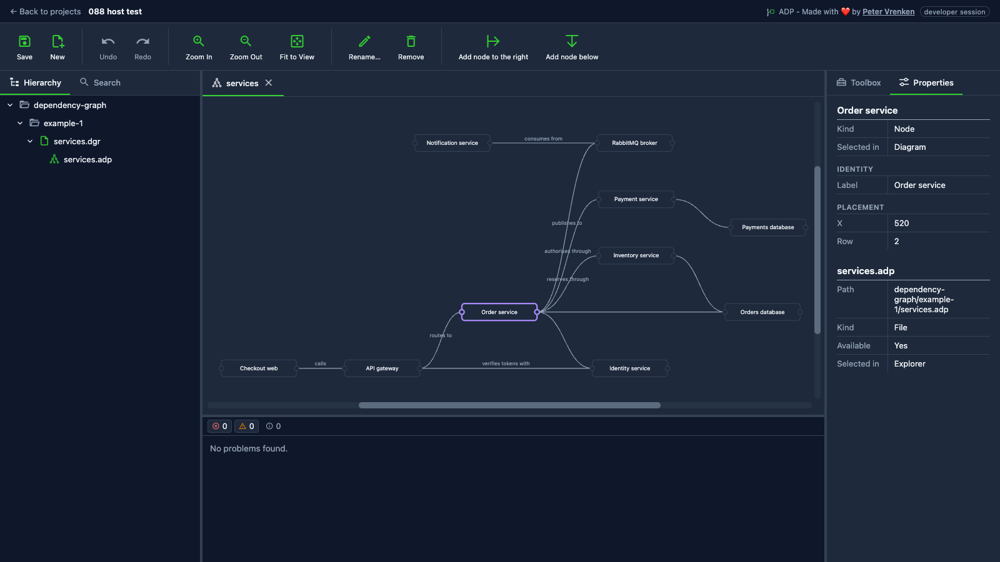
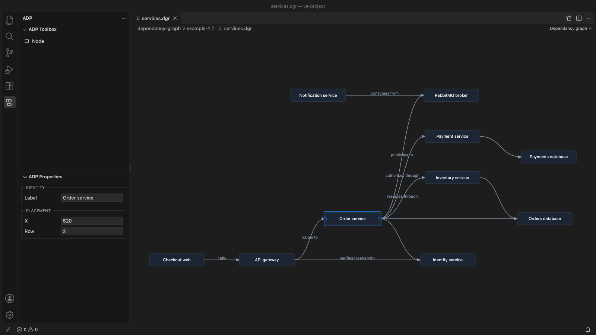
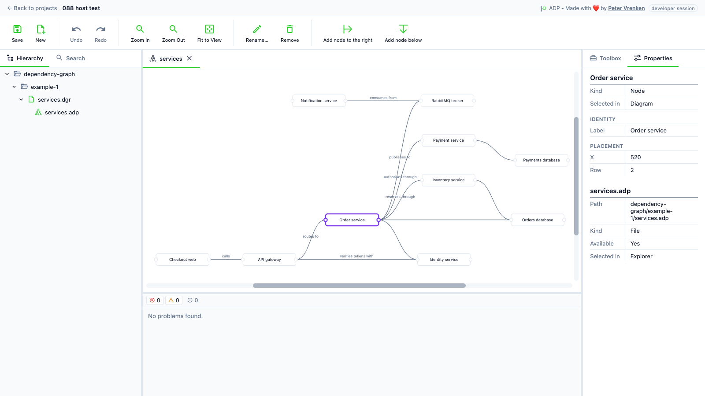
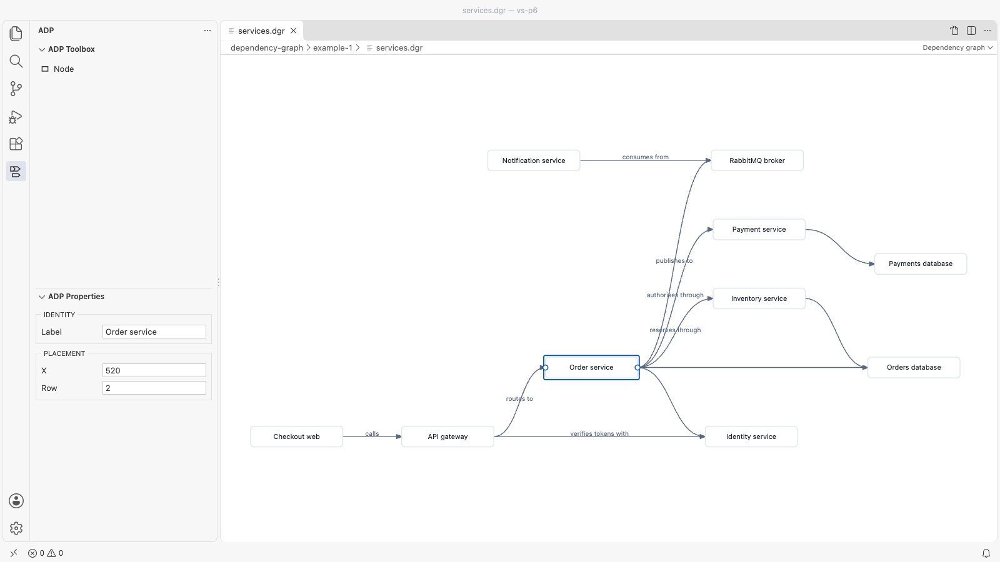

# Host test: Dependency graph

The dependency graph (`generic/dependencies`, `.dgr`) in Visual Studio Code, side by side with the standalone host, and a new user's first graph. etalii.adp spec [088](https://github.com/etalii-adp/etalii.adp/tree/develop/specs/088-vscode-dependency-graph), task T033 (SC-001, SC-004, FR-026), tasks taken from etalii.adp commit `a2327fe`.

## Setup

- **Date**: 2026-11-23, on the Mac mini (macOS, Apple silicon).
- **VS Code**: 1.143.1, with this repository's `develop` at `3428b80` packaged by `npm run package` (`etalii-adp-0.1.1.vsix`) and installed with `code --install-extension`. The comparison ran in a window with an empty profile and only this extension, at 1600×900 CSS pixels, in Dark Modern and Light Modern.
- **Standalone host**: `etalii.adp.ide.standalone` `develop` at `4302e13`, run from source as its README says (backend `dotnet run` in the `developer` environment, client `npm run dev`), signed in as the developer session, in Chrome at 1600×900, its light and dark themes chosen by the browser's colour scheme.
- **Document**: a copy of `examples/dependency-graph/example-1/services.dgr` with its `services.adp` in each host. The two hosts' copies of the example are the same bytes, apart from the final newline of `services.adp`, which standalone's lacks.
- The screenshots below are in [`dependency-graph/`](dependency-graph/).

## Side by side (SC-001)

| | Standalone | Visual Studio Code |
|---|---|---|
| Dark |  |  |
| Light |  |  |

### What is the same

- **Nodes**: every node at its `x` and on its row; boxes 160×36 with a 6 pixel radius; fill, border and text in the standalone colours in both themes (dark: fill `#1e293b`, border `#334155`; light: fill white, border `#e2e8f0`, text `#0f172a` at 12 pixels).
- **Dependency curves and loops**: the same SVG path for every dependency, read from the computed `d` attributes, the horizontal curves between facing sides and the forward loops alike; line 1.5 pixels in `#94a3b8` (dark) and `#64748b` (light).
- **Labels**: above the middle of the line, 11 pixels, in the line's colour, the same seven labels.
- **Findings**: none in either host for `services.dgr`.
- **Menus**: a node offers Rename…, Remove, Add node to the right and Add node below; a dependency Relabel… and Remove dependency; empty canvas Add node here. Same entries, same words, same order.
- **ADP Properties**: a node shows Label under Identity, and X and Row under Placement, as text lines (X `520`, Row `2` for Order service); a dependency shows Label, and its two ends as read-only rows "Depends on (from)" and "Depended on (to)" with the node ids.

### Every visible difference

| # | Difference | Standalone | VS Code | Kind |
|---|---|---|---|---|
| 1 | Arrowheads | **None drawn**: each dependency line names `marker-end: url(#dependency-graph-arrowhead)` in `dependency-graph.css`, and no marker with that id exists in the page ([picture](dependency-graph/standalone-no-arrowheads.png)) | A filled triangle at the dependency's end, in the line's colour ([picture](dependency-graph/vscode-arrowheads.png)), as FR-009 and the definition say | Standalone bug, reported below |
| 2 | Anchor dots | On both sides of every node, always | On both sides of the selected node only | Host convention; not in `parity.md` |
| 3 | Selection colour | Purple outline and dots (`#a78bfa` dark, `#7c3aed` light); a selected dependency turns purple | VS Code's focus blue (`#0078d4` dark, `#005fb8` light) as a frame around the box; a selected dependency turns blue and 3 pixels wide | Host convention (every diagram here uses the focus colour) |
| 4 | Canvas background | `#1e293b` in dark, white in light, with scrollbars | The editor's background (`#1f1f1f` in Dark Modern, white in Light Modern), no scrollbars | Host convention |
| 5 | First view | Opens at the standalone zoom, the graph smaller and to the left, scrollbars showing more space | Opens fitted, the whole graph centred at about 1.4 times standalone's size | Host convention (`parity.md`, "shown whole when that leaves it readable") |
| 6 | Menu shortcuts | The menus show no keys; the same actions are in the ribbon above the canvas | Each menu entry shows its key: F2, Delete, Tab, Enter ([standalone](dependency-graph/standalone-dependency-menu.png), [VS Code](dependency-graph/vscode-dependency-menu.png)) | Host convention |
| 7 | ADP Properties header | A title (the node's label) with Kind and Selected in rows, then the `.adp` file's Path, Kind, Available and Selected in | Only the Identity and Placement groups | Host convention |
| 8 | A dependency's end rows | Each read-only end row carries the sentence "Reconnecting is done on the canvas, by dragging the dependency's end to another node." | The rows show the id only | Difference; the sentence itself is questionable, see below |
| 9 | A dependency's Kind | Kind says **Node** for a selected dependency | No Kind row | Standalone bug, reported below |

None of rows 2 to 8 is one of spec 088's 22 inventory rows; rows A1 to E3 were not seen again. Rows 1 and 9 are the standalone host's.

## A new user (SC-004)

Someone who has never used ADP, in a fresh VS Code profile with an empty folder open, Light Modern, starting from the Command Palette. The goal: three nodes joined by two dependencies, using only what the UI shows.

| Step | What I did | What happened |
|---|---|---|
| 1 | Command Palette, typed "New Dependency" | One match, "ADP: New Dependency graph". |
| 2 | Enter | A save dialog titled "New Dependency graph" asks where to put the file, prefilled with `untitled.dgr` in the open folder. With the platform's own dialogs this is macOS's save sheet. |
| 3 | Enter (OK) | `untitled.dgr` is written (`dependencies: 1`, `elements: []`) and opens in the diagram: **an empty white canvas with nothing on it**, and the Explorer still in the side bar ([picture](dependency-graph/new-user-empty-canvas.png)). |
| 4 | Right-click on the canvas | One entry, "Add node here". |
| 5 | Add node here | "New node" appears where I clicked; the tab is marked modified. |
| 6 | Click the node | Its frame and its two dots show. |
| 7 | Tab | A second "New node" 240 to the right, joined by a dependency with its arrowhead. The first node stays selected. |
| 8 | Enter | A third "New node" one row down, joined to the first by a dependency. Three nodes, two dependencies ([picture](dependency-graph/new-user-three-nodes.png)). |

Six gestures after the palette, with no error, no refusal and nothing that needed the documentation; a person at an ordinary pace takes well under the two minutes SC-004 allows (driven by a script, the steps took about 20 seconds). I also tried the other ways in:

- **ADP: Add Node** from the Command Palette asks for the label ("Add node", field Label, prefilled "New node") and places it 240 to the right of the selected node, as FR-014 says.
- **Dragging a dot** onto empty canvas creates "New node" there with a dependency on it, as one undo step.
- **ADP Toolbox**, reached from the ADP icon in the activity bar: clicking Node adds one at the centre of the view.
- **ADP Properties** shows and edits the selected node's Label, X and Row; a label with `: ` in it is written quoted and reads back.

### Hurdles, each however small

1. **The empty canvas says nothing.** After step 3 there is a blank white editor: no hint to right-click, no toolbox in view (the side bar stays on the Explorer) and no message. Someone who does not think of right-clicking has nothing to go on. The ADP side bar opens only when its activity-bar icon is found.
2. **The dots are small to hit.** They are 8 pixels across, centred on the box's edge. A press 4 pixels inside a dot, on the box, drags the node instead of drawing a dependency; I moved a node by accident this way before I hit the dot.
3. **A node made by dropping a dependency on empty canvas** lands with its left edge at the drop point, so a drop near the right of the view leaves it mostly outside the view, and the view does not follow it.
4. **The toolbox's Node lands on top of a node already there.** In my graph the centre of the view held a node; the new one covered most of its label ([picture](dependency-graph/new-user-toolbox-overlap.png)).
5. **Tab and Enter keep the selection on the original node.** Pressing Tab twice gives a fan from one node, not a chain; to continue from the new node, it has to be clicked first. The standalone host does the same.
6. **The loop to a node below** leaves the right dot, turns back and runs diagonally behind both boxes to the left side of the new node ([VS Code](dependency-graph/new-user-three-nodes.png), [standalone](dependency-graph/standalone-node-below.png)). It is the companion's curve and the standalone host draws it the same way, but it is hard to read where it goes.
7. **Nothing is saved until Save.** Every step marks the tab modified; this is VS Code's ordinary behaviour, and a new user who closes the window is asked, but the file on disk stays the empty template until then.

Hurdles 5 and 6 are the definition's, shared with the standalone host; 1 to 4 are this host's.

## Bugs found

- **Standalone: no arrowheads.** Open any `.dgr` in the standalone host: no dependency has an arrowhead. `src/diagrams/dependency-graph/client/dependency-graph.css` gives `.dependency-graph-relation-line` `marker-end: url(#dependency-graph-arrowhead)`, and the canvas defines only the shared `library-arrow`, `library-open-arrow`, `library-diamond` and `library-circle` markers, so the reference resolves to nothing.
- **Standalone: a dependency's Kind is Node.** Select a dependency in `services.dgr` (for example "calls") and open Properties: Kind reads "Node".
- **Standalone: the end rows promise a gesture that does not exist.** Spec 088 says reconnecting a dependency's end is absent from the standalone host, yet Properties says "Reconnecting is done on the canvas, by dragging the dependency's end to another node." Either the gesture or the sentence is wrong.
- **VS Code, seen twice and not reproduced: a document read twice over.** During the driving of one VS Code window, after the colour theme had been changed through the theme picker (which sent some keys to the diagram) and the window restarted, every `.dgr` opened in that window, new copies included, showed three `fbl.duplicate-key` warnings at lines 86, 89 and 130 of an 85-line file, and "Reopen Editor With… Text Editor" showed the text twice (171 lines) while the tab was not modified and the file on disk was unchanged. It survived "Developer: Reload Window" and went away when VS Code was quit and started again. I could not bring it back with a fresh profile, a reload, a theme change or typing into the canvas. Recorded so that it is recognised if it is seen again.

## Verdict

Nothing blocking: VS Code draws `services.dgr` as the definition says, in both themes, and every difference from the standalone host above is a host convention or a standalone bug. A new user reaches three connected nodes with no error and no refusal; the hurdles above are left to a follow-up.
