# Host test: Timeline diagram

The timeline diagram (`generic/timeline`, `.tml`) in Visual Studio Code, side by side with the standalone host, the largest example's speed, and a new user's first timeline. etalii.adp spec [091](https://github.com/etalii-adp/etalii.adp/tree/develop/specs/091-vscode-timeline), task T031 (SC-001, SC-004, SC-005), tasks taken from etalii.adp commit `37b1e653`.

## Setup

- **Date**: 2026-11-25, on the Mac mini (macOS 27.2, Apple silicon).
- **VS Code**: 1.147.0, with this repository's `develop` at `1563e5f` packaged by `npm run package` (`etalii-adp-0.2.3.vsix`) and installed with `code --install-extension` into an empty profile with only this extension, at 1600×900 CSS pixels, in Dark Modern and Light Modern. The window was driven over the Chrome DevTools protocol, as [`docs/screenshots/capture.mjs`](../screenshots/capture.mjs) drives it.
- **Standalone host**: `etalii.adp.ide.standalone` `develop` at `9555565`, run from source as its README says (backend `dotnet run` in the `developer` environment, client `npm run dev`), signed in as the developer session, at a 1600×900 CSS pixel viewport, its light and dark themes chosen by the browser's colour scheme. Its pictures below are at half resolution: the browser they were taken in shows a 1600 pixel page in 800 pixels.
- **Documents**: copies of this repository's four examples under `examples/timeline/` (`example-1`, `example-2`, `marvel-universe`, `marvel-universe-overview`), the same bytes in both hosts. The standalone repository's own `example-2/roadmap.tml` has other dates by now; this repository's copy was opened in both.
- The pictures below are in [`timeline/`](timeline/).

## Side by side (SC-001)

| | Standalone | Visual Studio Code, first view |
|---|---|---|
| `example-1`, dark | 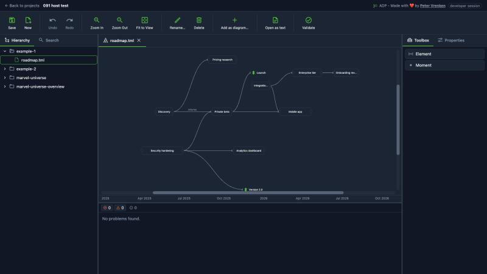 | 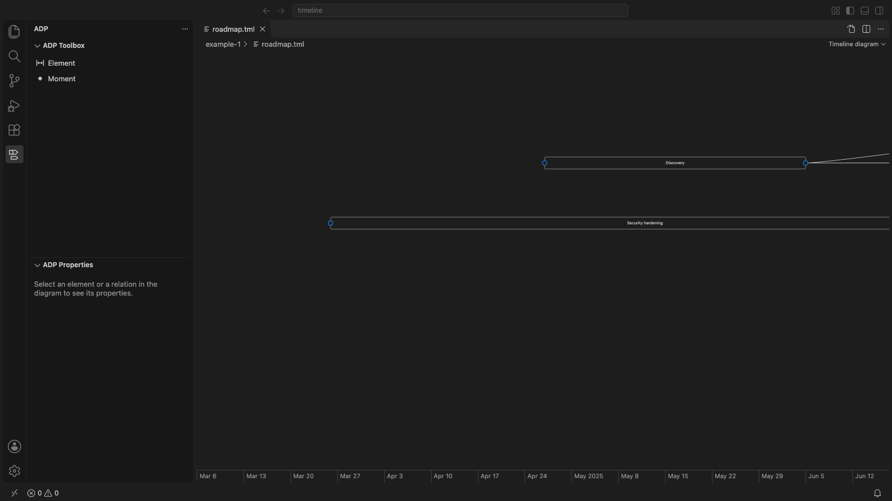 |
| `example-1`, light | 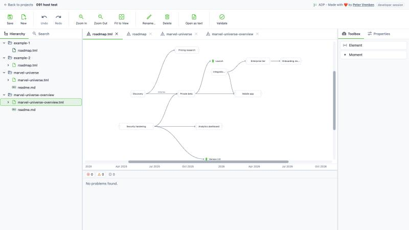 | 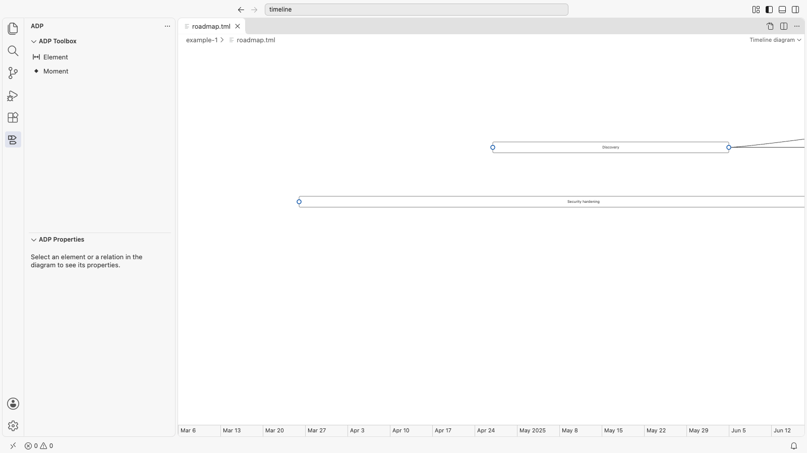 |
| `marvel-universe-overview`, dark | 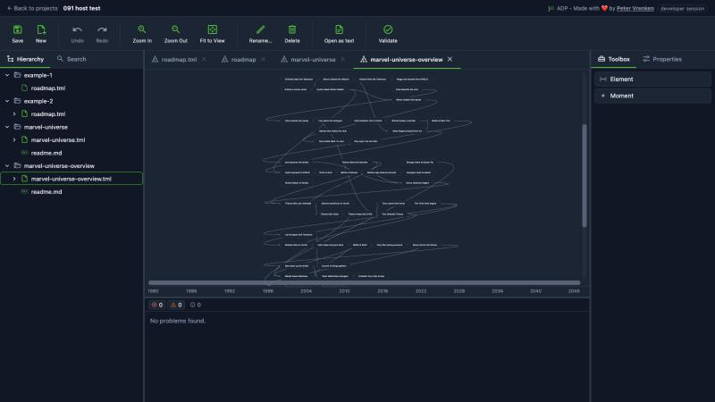 | 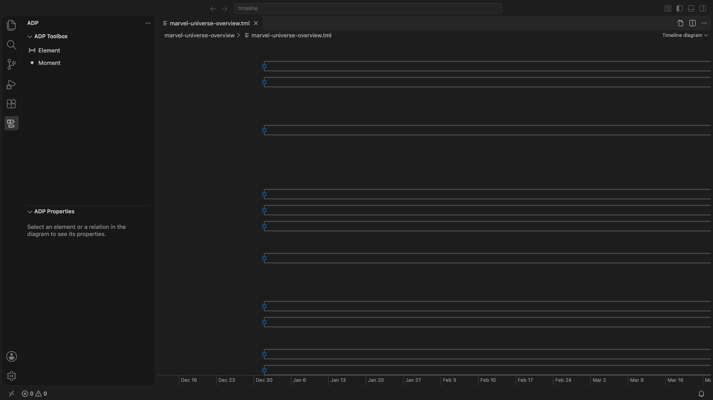 |
| `marvel-universe-overview`, light | 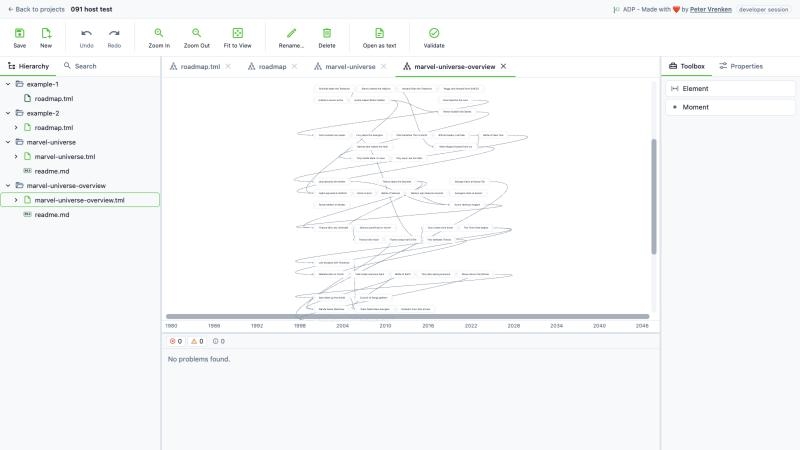 | 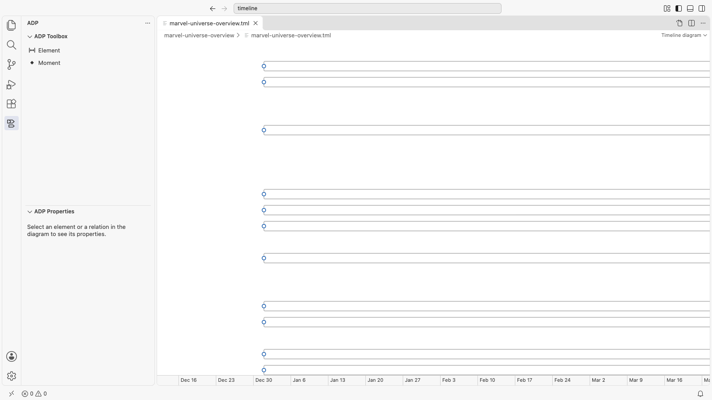 |

### What is the same

- **What is drawn**: every period, moment and connection of all four examples, counted in each host's page: `example-1` 9 periods, 2 moments, 10 connections (1 with a label); `example-2` 25, 4 and 36 (1 labelled); `marvel-universe-overview` 47, 0 and 50; `marvel-universe` 428, 0 and 479.
- **Findings**: none in either host for any of the four.
- **Rows**: 60 units apart; a period 36 units high from its row's top; a moment an 18 by 18 diamond whose left point is its begin, 0.3 of a row down, with its label to its right.
- **Connections**: from the source's end to the target's begin, 1.5 pixels wide, a label above the middle; every element shows a dot at its begin and its end.

### Every visible difference

| # | Difference | Standalone | VS Code | Kind |
|---|---|---|---|---|
| 1 | Time scale and first view | The scale is fitted to the document's whole span when it opens, about 1,200 units for all of it (`example-1`: 2 units a day), so every document opens whole: a year and a half of roadmap, or 1701 to 2331 for `marvel-universe` | 20 units a day, the definition's fixed `scale`, and the first view is the drawing's top-left corner at 60 percent ([parity.md](../parity.md)): about three months. `example-1` opens on 6 March to 29 May 2025 with two bars in view; `marvel-universe-overview` opens on bare bars whose labels are out of view ([picture](timeline/vscode-overview-light.png)), and centred on its middle it is no better ([picture](timeline/vscode-overview-centred-light.png)). Zooming scales rows and time together, so zoomed out to the whole of `example-1` the rows are 7 pixels apart and no label can be read ([picture](timeline/vscode-example-1-zoomed-out-light.png)); the furthest zoom, 5 percent, shows about four years of `marvel-universe`'s six centuries | Definition: timeline.md calls the fitted scale the standalone implementation's own and timeline.dis states 20 units a day; raise in etalii.adp |
| 2 | Moments | A filled diamond, `#32cd32`, in both themes (`client/timeline.css`) | **No diamond**: the shape is filled with the editor's background and has no line, so only the label and the two dots show ([light](timeline/vscode-moments-light.png), [dark](timeline/vscode-moments-dark.png)) | VS Code bug: the definition's `moment` style fills with the token `color.accent`, which it gives no value, and this host paints a token without a value in the editor's background; see below |
| 3 | Connections and arrowheads | A horizontal curve out of the source's end and into the target's begin from the left, with the arrowhead before the target; a target that begins before the source ends gets a loop forward and back | The curve arrives travelling left, from inside the target, so its arrowhead points left and lies under the target's fill: **no arrowhead is seen**, and a connection to an element that begins earlier looks attached to that element's right end ([picture](timeline/vscode-moments-dark.png), [new user](timeline/new-user-moment.png)) | Definition: timeline.dis says `endDirection: "left"`, which DISL reads as the direction the line runs (its own timeline example says `"right"` with `backward: "loop"`); raise in etalii.adp |
| 4 | Colours | Dark: fill `#1e293b`, border `#334155` at 1.5 pixels, label `#f1f5f9`, connection `#94a3b8`. Light: fill white, border `#e2e8f0` at 1.5 pixels, label `#0f172a`, connection `#64748b` | The editor's colours, as for every diagram here: fill the editor background (`#1f1f1f` / white), border and connection the editor foreground (`#cccccc` / `#3b3b3b`), border 1 pixel | Host convention; the definition's tokens carry no values |
| 5 | Corner radius | 6 | 4, as timeline.dis says | Standalone differs from its definition |
| 6 | Label sizes | Moment label 12 pixels; connection label 11 pixels in the line's colour | Moment label 14 pixels; connection label 14 pixels in the editor foreground, with a halo | Host convention; the definition sets no size for either |
| 7 | Ruler | 10 pixels, in `#94a3b8` / `#64748b` on a translucent bar; at the fitted scale it steps in quarters or years | 11 pixels, the editor's colours; at the first view it steps in weeks, and a year is named only on a tick that falls on the first of a month, so `marvel-universe-overview`'s first view (16 December to 9 March) names no year at all | Follows from row 1; the missing year is this host's |
| 8 | Dots | In the element's own fill and border | A ring in the focus colour (`#0078d4` / `#005fb8`) | Host convention |

Rows 1, 2 and 3 are what a user of `marvel-universe-overview` sees first: bars without labels, no moments and no arrowheads, and no way to see the whole timeline.

## The largest example (SC-004)

`marvel-universe.tml`: 3,585 lines, 428 periods and 479 connections, opened from Quick Open three times in the installed extension.

| Run | First drawn | All 907 drawn |
|---|---|---|
| 1 | 284 ms | 512 ms |
| 2 | 271 ms | 486 ms |
| 3 | 262 ms | 486 ms |

Panning and zooming, 60 wheel steps each at the first view and again zoomed fully out: the time between frames had a median of 16.7 ms, a 95th percentile of 18.3 to 18.7 ms and a maximum of 20.8 ms, with no frame over 50 ms. No stutter was seen. Because of row 1 above, the whole timeline is never in view: at the furthest zoom about four years of it are.

## A new user (SC-005)

Someone who has never used ADP, in a fresh profile with an empty folder open, Light Modern, starting from the Command Palette. The goal: three periods, one moment and one connection, using only ADP Toolbox, the canvas and ADP Properties.

| Step | What I did | What happened |
|---|---|---|
| 1 | Command Palette, typed "New Timeline" | Two matches: "ADP: New Timeline diagram" and Visual Studio Code's own "Explorer: Focus on Timeline View". |
| 2 | Enter | A save dialog titled "New Timeline diagram", prefilled with `untitled.tml` in the open folder. macOS's own save sheet cannot be driven by the script, so the profile used Visual Studio Code's own dialog (`files.simpleDialog.enable`); with the save sheet, the first attempt wrote `untitled.tml` but no editor came up in the window, which was not looked into further. |
| 3 | OK | `untitled.tml` is written (`timeline: 1`, `elements: []`) and opens in the diagram with ADP Toolbox and ADP Properties in the side bar: **an empty canvas, and a ruler that reads "Jan 1970"** ([picture](timeline/new-user-empty-canvas.png)). |
| 4 | Clicked Element in ADP Toolbox | "New element" appears in the middle of the view, from **1970-02-01 to 1970-02-15**, row 6. The ruler names no year. |
| 5 | Selected it; in ADP Properties set Begin to `2026-01-05` | The element **disappears**: its end is now before its begin, a warning appears in the status bar, and the canvas says nothing ([picture](timeline/new-user-element-gone.png)). |
| 6 | Set End to `2026-02-15` | The warning goes, but the element is now 56 years away from the view, which stays in 1970. There is no command to show the whole timeline or the selection; I found it again only by closing the tab and opening the file again. |
| 7 | Selected it; pressed Tab, then Enter | Tab adds "New element" after it (2026-02-21 to 2026-03-07, same row) with a connection to it; Enter adds one below it (row 7, 2026-01-05 to 2026-01-19), connected too. Three periods. |
| 8 | Clicked Moment in ADP Toolbox | **Nothing happened**, and Element no longer did anything either, until Developer: Reload Window. Afterwards Moment added "New moment" on 2026-02-03, row 5: **a label and two dots, no diamond** ([picture](timeline/new-user-moment.png)). |
| 9 | Dragged from the third period's end dot to the second period's begin dot | A line follows the pointer to the dot ([picture](timeline/new-user-connect-on-dot.png)). Let go on the dot, it **makes a new element exactly on top of the second one**, same dates and row, connected to it, instead of connecting the two. One Undo takes both away. |
| 10 | The same drag, let go on the second period's bar | The connection is made ([picture](timeline/new-user-done.png)). |

The goal is reached, three periods, a moment and a connection, with one warning on the way and no error dialog, but not without help: steps 3 to 6 and 9 stop a new user, and step 8 would make the toolbox look broken.

### Hurdles, each however small

1. **"Timeline" is also Visual Studio Code's.** Typing "New Timeline" offers the Explorer's Timeline view next to the ADP command.
2. **A new timeline starts in 1970.** The empty canvas has no hint, its ruler reads "Jan 1970", and the first element from the toolbox lands in February 1970, at the Unix epoch, rather than today.
3. **An element vanishes while its dates are typed.** Setting the begin first puts it after the end; the element is no longer drawn and only the status bar's warning count says why.
4. **The view does not follow.** An element moved in time through ADP Properties leaves the view and cannot be brought back: there is no fit or go-to-selection, and zooming out shrinks the rows with the time (row 1 above).
5. **Moments are invisible** (row 2 above): a new user who adds one sees only "New moment" and two dots.
6. **Letting go on a begin dot makes a duplicate.** The dot is the obvious target for a connection drawn from an end dot; it is read as empty canvas, so a new element is made on top of the target. Only the bar's body connects.
7. **No arrowheads** (row 3 above): the direction of a connection cannot be seen, and a connection to an earlier element looks attached to its right end.
8. **The ruler hides the year** at the first zoom unless a tick falls on the first of a month.
9. **The toolbox went dead once** (step 8): neither entry did anything until the window was reloaded. It came after the tab had been closed and opened again; closing and opening it again later did not bring it back, so the cause is not known.
10. **Dragging from ADP Toolbox was not tried**: the script cannot make a drag between two webviews, so the toolbox was clicked, which adds at the middle of the view.
11. The new file is written with CRLF line endings on macOS too; the definition's binding says `"newline": "crlf"`.

## Bugs found

None is fixed in this change.

- **VS Code: moments are not drawn.** Open any `.tml` with a moment, such as `examples/timeline/example-1/roadmap.tml` (Launch, Version 2.0): only the label and the dots appear. The `moment` style fills with `{ "token": "color.accent" }` and a line of width 0; `colourOf` in `src/webview/diagram/scene.ts` paints a token without a value in the editor's colour for the role, which for a fill is the editor background. The host needs a colour for `color.accent`, and the definition a value for it.
- **VS Code: letting go on a begin dot makes a new element.** Draw a connection from an element's end dot and let go on another element's begin dot: a new "New element" is written on top of that element, with the connection to it. `connect` in `src/webview/diagram/canvas.ts` takes the target from `document.elementFromPoint`, which is the overlay's dot, not an element, so the line is read as let go on empty canvas.
- **VS Code: a new timeline starts at the Unix epoch.** ADP: New Timeline diagram opens on January 1970 and the first element from the toolbox is dated 1970-02-01.
- **VS Code, seen once and not reproduced: the toolbox stopped adding.** After the timeline's tab had been closed and opened again and Tab and Enter used, clicking Element or Moment in ADP Toolbox did nothing until Developer: Reload Window.
- **Definition: connections arrive from the wrong side.** timeline.dis says `"endDirection": "left"`; DISL takes a direction as the way the line runs, so the curve enters its target from the right and hides its arrowhead. The standalone host draws it entering from the left, with a forward loop for a target that begins earlier, which DISL states as `"endDirection": "right"` with `"bezier": { "backward": "loop" }`.
- **Definition: the time scale.** The standalone host fits the scale to the document; timeline.dis states 20 units a day, which shows three months of a roadmap and never the whole of a long timeline.

## Verdict

Blocking. Visual Studio Code reads and draws all four examples without a finding, as fast as SC-004 asks, and a new user can reach three periods, a moment and a connection; but moments are not drawn, connections show no arrowheads, a long timeline can never be seen whole or readably, a new timeline starts in 1970, and letting go on a dot duplicates an element. The timeline stays a work in progress in [tools.md](../tools.md) until rows 1 to 3 and the bugs above are settled.

## Re-check after the fixes

The same tests on 2026-11-25, after [#122](https://github.com/etalii-adp/etalii.adp.ide.vscode/pull/122) (moments in the theme's accent colour, a line let go on a dot connects), [#123](https://github.com/etalii-adp/etalii.adp.ide.vscode/pull/123) (the time axis fitted to the document when it opens) and [#125](https://github.com/etalii-adp/etalii.adp.ide.vscode/pull/125) (a line's end direction is the side it enters by). This repository's `develop` at `2cf32f8`, packaged as `etalii-adp-0.2.4.vsix` and installed into a fresh profile, on the same Mac, Visual Studio Code 1.147.0, 1600×900, both themes. The standalone host is unchanged (`9555565`), so its pictures above still stand beside these.

### Rows 1, 2 and 3

| | Light | Dark |
|---|---|---|
| `example-1` / `example-2` | 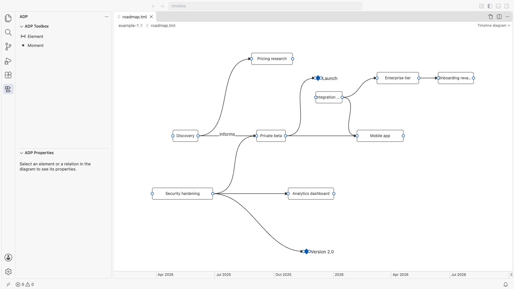 | 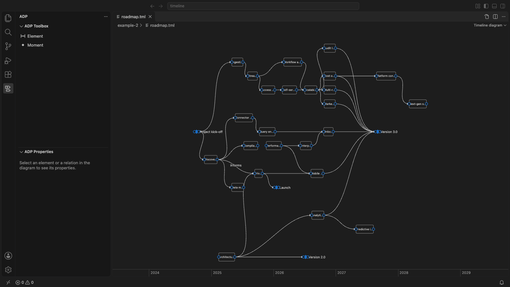 |
| `marvel-universe-overview` | 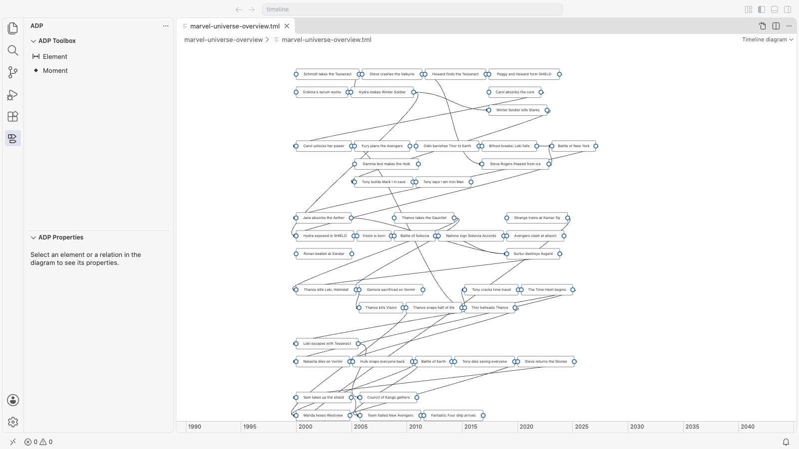 | 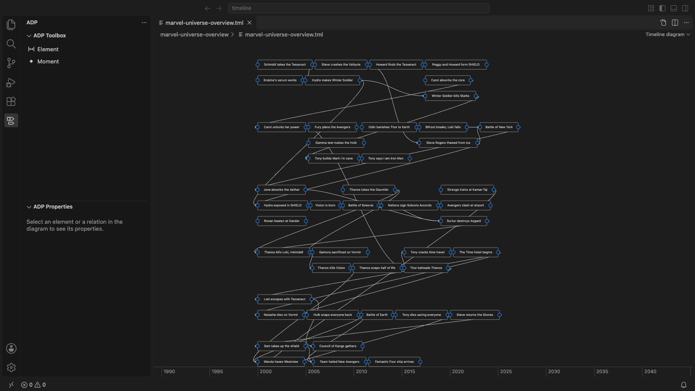 |

| # | Then | Now | Result |
|---|---|---|---|
| 1 | About three months in view at 20 units a day; a long timeline never readable whole | Every example opens with its whole span of time in view and its labels readable: `example-1` from April 2025 to July 2026, `example-2` 2024 to 2029, both overviews 1990 to 2040, the ruler naming years. All the rows of `example-1` and `example-2` are in view. `marvel-universe-overview`'s last row (row 20, Strange's spell goes wrong and World forgets Peter Parker) lies under the ruler: the drawing ends 36 pixels below the ruler's top. `marvel-universe` has 233 rows, and about 20 of them are in view, so the rest are reached by scrolling down ([picture](timeline/recheck-marvel-universe-light.png)); the standalone host draws all 233 in one column too small to read | Passes for time. The overview's last row is hidden, which is a small bug of the fit. The tall document opening at a readable size is this host's convention ([parity.md](../parity.md)) |
| 2 | No diamond | A filled diamond in the theme's accent colour, in both themes ([picture](timeline/recheck-arrowheads-dark.png)). Its two dots cover most of it, as the standalone host's dots do | Passes |
| 3 | No arrowheads; lines entering from the right | Every line enters its target from the left, with a filled arrowhead before the target's begin, pointing into it ([picture](timeline/recheck-arrowheads-dark.png)) | Passes |

Two smaller differences remain. A connection to a target that begins before its source ends runs straight back underneath the source's bar, where the standalone host loops forward and back ([picture](timeline/recheck-new-user-done.png)); timeline.dis does not ask for the loop (`bezier.backward`). On a short bar, the begin dot covers the first letter of its label ("ntegration ...", "ngesti..."), as in the standalone host.

### `marvel-universe.tml` (SC-004)

| Run | First drawn | All 907 drawn |
|---|---|---|
| 1 | 460 ms | 684 ms |
| 2 | 306 ms | 497 ms |
| 3 | 302 ms | 519 ms |

Pan and zoom, 60 wheel steps each and again zoomed fully out: median 16.7 ms between frames, 95th percentile 17.2 to 18.9 ms, maximum 35.8 ms, no frame over 50 ms. No stutter. Passes.

### A new user, again (SC-005)

The same steps, in a fresh profile with an empty folder, Light Modern.

| Step | Now |
|---|---|
| "New Timeline" in the Command Palette | Still two matches, the ADP command and Explorer: Focus on Timeline View. |
| ADP: New Timeline diagram, OK | `untitled.tml` opens with ADP Toolbox, on an empty canvas whose ruler reads "Jan 1970". |
| Element from ADP Toolbox | **"New element" from 1970-02-01 to 1970-02-15** ([picture](timeline/recheck-new-user-1970.png)): etalii.adp [#853](https://github.com/etalii-adp/etalii.adp/issues/853), still open. |
| Begin set to `2026-01-05` in ADP Properties | **The element disappears**, with one warning in the status bar. |
| End set to `2026-02-15` | The element is valid again but drawn 56 years from the view, which stays on February 1970 ([picture](timeline/recheck-new-user-out-of-view.png)). There is still no command to show the whole timeline or the selection; the fit of #123 happens only when the file opens, so I closed the tab and opened the file again. |
| Tab, Enter | A period after it and one below it, each connected: three periods. |
| Moment from ADP Toolbox | "New moment" on 2026-01-11, a visible diamond. The toolbox kept working after the tab had been closed and opened again. |
| A line from the third period's end dot, let go on the second period's begin dot | **It connects** (`from: ptz7o5d5`, `to: waockcl2`), with no new element ([picture](timeline/recheck-new-user-done.png)). Let go outside the window, a line still makes a new element where it ends, as the definition says for empty canvas. |

No error dialog, and the goal is reached. What is left for a new user:

1. **A new timeline starts in 1970** (etalii.adp #853).
2. **The element vanishes while its dates are typed**, and once the dates are right it is far from the view. There is no way to bring it into view short of opening the file again: no fit or go-to-selection command, and the view does not follow an element moved through ADP Properties.
3. "Timeline" still also finds Visual Studio Code's own Timeline view.

### Verdict of the re-check

Rows 2 and 3 pass, and row 1 passes for time, apart from `marvel-universe-overview`'s last row lying under the ruler. SC-004 passes. The line let go on a dot is fixed. The new-user rule, no errors or hurdles, is not met yet: hurdles 1 and 2 together leave a new user's first element in 1970 and then out of sight, with no way to bring it back except opening the file again. So the timeline stays 🛠️ Work-in-progress in [tools.md](../tools.md). It can move to ⚗️ Prototype once a new timeline starts near today (#853) and an element changed through ADP Properties stays in view or can be brought into view, and the overview's last row is clear of the ruler.

None of these is fixed in this change:

- **VS Code: the fit leaves the last row under the ruler.** `marvel-universe-overview.tml` opens with its drawing reaching 790 pixels into a 777 pixel surface whose ruler starts at 754, so row 20 is hidden.
- **VS Code: the view does not follow an element moved through ADP Properties**, and there is no command to show the whole document or the selection.
- **etalii.adp #853**: a new timeline starts at the Unix epoch.

## Second re-check, after #127

On 2026-11-25, after [#127](https://github.com/etalii-adp/etalii.adp.ide.vscode/pull/127) (a new timeline on the weeks around today, an element changed in ADP Properties brought into view, a timeline that all but fits placed above the ruler): `develop` at `b1e5850`, packaged as `etalii-adp-0.2.4.vsix` and installed into fresh profiles, on the same Mac and Visual Studio Code 1.147.0, in both themes. The standalone host is unchanged (`9555565`), so its pictures above still stand beside these.

### The three hurdles

| # | Hurdle | Now | Result |
|---|---|---|---|
| 1 | A new timeline starts in 1970 | The first element from ADP Toolbox is dated **2026-12-11 to 2026-12-25**, about two weeks after today, and the ruler then shows November 2026 to February 2027 ([picture](timeline/recheck2-new-element.png)). But the new, empty timeline itself shows **a blank ruler with no dates** and no hint ([picture](timeline/recheck2-new-empty.png), [dark](timeline/recheck2-new-user-dark.png)) | Half: the first element is near today, but the empty canvas does not show the weeks around today ([#129](https://github.com/etalii-adp/etalii.adp.ide.vscode/issues/129)) |
| 2 | An element changed in ADP Properties leaves the view | Begin set to 2027-03-01, then End to 2027-04-15: the element is drawn in the middle of the view, which has moved to February to May 2027 ([picture](timeline/recheck2-end-typed.png)) | Passes |
| 3 | `marvel-universe-overview`'s last row under the ruler | Measured at four editor heights. **777 pixels** (1600×900 window, the screenshots' size): the drawing reaches 790, the ruler starts at 754, so row 20 is still under it ([picture](timeline/recheck2-overview-777.png)). **799 pixels** (breadcrumbs hidden): placed clear, 17 to 759 above a ruler at 776 ([picture](timeline/recheck2-overview-799.png)). 481 and 503 pixels (panel open): the overview is taller than the room, so it opens at the readable size from the top and scrolls, as intended | Fails at 777 pixels: at 60 percent the overview is 742 pixels tall, and #127 places it above the ruler only with 8 pixels to spare at each end, 758 in a room of 754 ([#128](https://github.com/etalii-adp/etalii.adp.ide.vscode/issues/128)) |

### Rows 1 to 3 and the timing

Rows 1 to 3 hold in both themes: `example-1` and `example-2` open whole and clear of the ruler; every overview opens with its whole span of time; moments are diamonds in the accent colour (`#005fb8` in Light Modern); every connection's arrowhead lies before its target and points into it. `marvel-universe.tml`: first drawn in 300 to 449 ms, all 907 shapes in 526 to 678 ms over three runs; panning and zooming at a median of 16.7 ms between frames, maximum 20.2 ms, none over 50 ms.

### The full onboarding, again

A fresh profile, an empty folder, Light Modern, then Dark Modern.

| Step | What happened |
|---|---|
| "New Timeline" in the Command Palette | Two matches, the ADP command and Explorer: Focus on Timeline View. |
| ADP: New Timeline diagram, OK | `untitled.tml` opens with ADP Toolbox, on a blank canvas with **an empty ruler** (#129). |
| Element from ADP Toolbox | "New element", 2026-12-11 to 2026-12-25, in view. |
| Begin set to 2027-03-01 in ADP Properties | **The element disappears**; a warning in the status bar is the only sign why ([picture](timeline/recheck2-begin-typed.png), [#130](https://github.com/etalii-adp/etalii.adp.ide.vscode/issues/130)). |
| End set to 2027-04-15 | The element is back, in view. Its selection frame is gone, though ADP Properties still shows it. |
| Double-click, typed "Design", Enter | Renamed in place; F2 does the same. |
| Tab, Enter, Moment from ADP Toolbox | A period after it, one below it, each connected, and a moment as a diamond. The line from Design to the period below, which begins on Design's own begin, runs back underneath Design to its begin, where the standalone host loops forward. |
| A line from the lower period's end dot to the right period's begin dot | Connected. |
| Dragged the right period by its body; dragged Design's right edge | Moved 9 days and lengthened 5 days, snapped to whole days. |
| Undo twice, Redo once, Save | Undone and redone step by step; the saved file says what the canvas shows. |
| Closed the tab and opened the file again | Opens fitted, as left. |
| Dark Modern | The same drawing in the dark theme ([picture](timeline/recheck2-new-user-dark.png)). |
| ADP: New Timeline diagram again, OK | **"untitled.tml already exists. Are you sure you want to overwrite it?"**: the second new timeline is offered the first one's name ([#131](https://github.com/etalii-adp/etalii.adp.ide.vscode/issues/131)). |

No error appeared, and every edit saved and undid as it should. The hurdles a new user still meets are an empty ruler on a new timeline (#129), an element that vanishes while its dates are typed (#130), an overwrite prompt on the second new timeline (#131), and the Explorer's own Timeline view in the Command Palette.

### Verdict of the second re-check

Not yet ⚗️ Prototype. Hurdle 2 is cleared; hurdle 1 is half cleared and hurdle 3 still fails at the 1600×900 window the screenshots are taken in; rows 1 to 3 and the timing hold. The new-user rule asks for no errors and no hurdles: there are no errors, but #128, #129 and #130 are hurdles on the way from creating a timeline to editing it, and #131 on making a second one. The row in [tools.md](../tools.md) stays 🛠️ Work-in-progress until they are settled. Each is its own issue, and none is fixed in this change.
